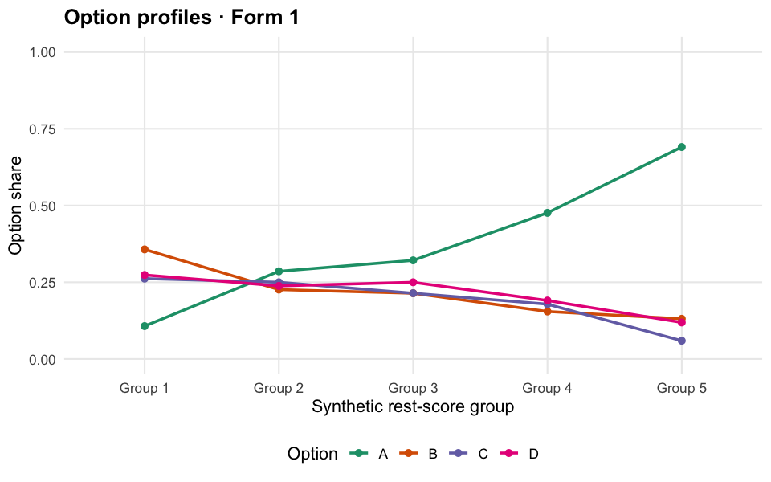

# Assessment Analytics Demo

An interactive R Shiny dashboard for exploring a **fully synthetic** assessment. Every item ID, response, score, review flag, and result in this repository is generated for the demo. It contains no real participant, exam, organization, or study data.

## What you can explore

- **Overview:** generated item counts and response summaries.
- **Item review:** classical statistics, illustrative 2PL and option curves, a unit-slope sensitivity view, review flags, and downloadable notes.
- **Evidence explorer:** browse and download 36 independently designed result tables across five invented topics, plus 15 generated figures.
- **Ability precision:** compare theoretical information and local standard error, with an optional unit-slope illustration.
- **Scoring:** try invented raw-to-reported score rules and a hypothetical threshold.
- **Results library:** search the generated CSV catalogue and preview source files.

The item parameters are **simulation inputs**, not fitted estimates. Fit tests, parameter intervals, form linking, and anchor analyses are not calculated by this demo; the corresponding panels say so. The review flags and score rules are examples of interface behavior, not operational decisions.



## Run locally

The generated CSVs, figures, and PDF atlases are already included. Install the R packages `shiny`, `bslib`, and `ggplot2`, then run from this repository folder:

```sh
Rscript -e 'shiny::runApp(".")'
```

## Rebuild and verify the synthetic assets

To regenerate the assets, also install the Python package `reportlab`. Then run:

```sh
Rscript generate_demo_data.R
Rscript generate_result_tables.R
Rscript generate_figures.R
python3 generate_atlases.py
Rscript verify_public_demo.R
Rscript audit_public_demo.R
```

The generators use fixed synthetic inputs and read no external datasets. The verifier checks the exact public file list and compares every generated asset with a clean regeneration. If your Python executable is not `python3`, set `DEMO_PYTHON` to its path when running the verifier.
